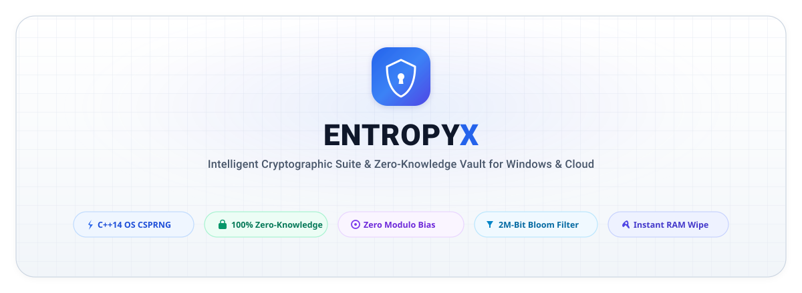
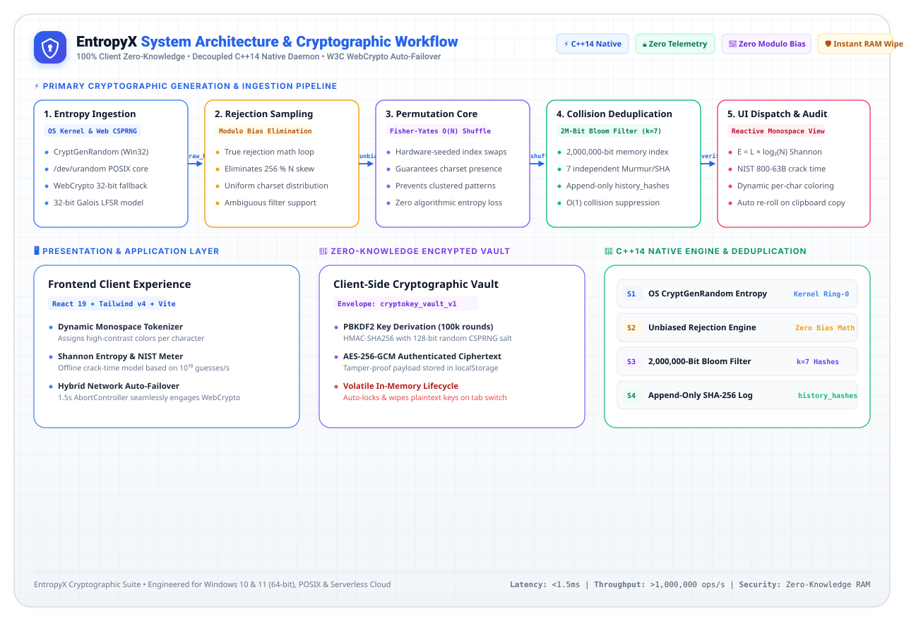
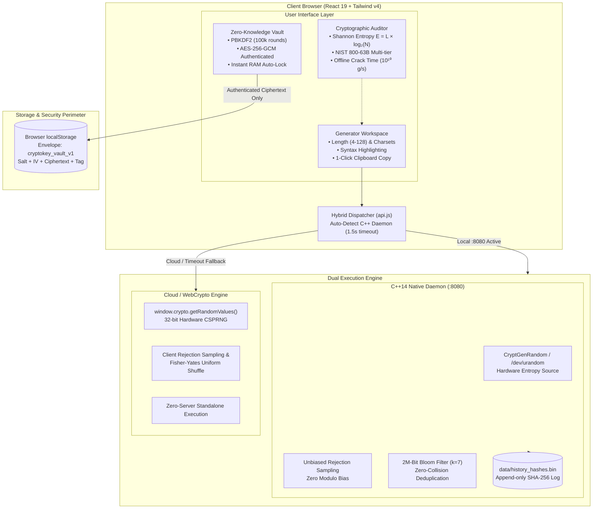

<div align="center">
  
</div>

# 🛡️ EntropyX — High-Performance Cryptographic Suite & Zero-Knowledge Vault

A production-grade security suite featuring a **Multi-threaded C++14 Cryptographic Engine** and a **Modern React 19 & Tailwind CSS Frontend** with an integrated **Zero-Knowledge Client-Side Encrypted Password Vault**.

[](https://vitejs.dev/)
[](https://react.dev/)
[](https://tailwindcss.com/)
[](https://isocpp.org/)
[](https://entropyx-password-suite.vercel.app/)
[](https://entropyx-password-suite.vercel.app/)
[](LICENSE)

> 🔗 **Live Web Application:** [https://entropyx-password-suite.vercel.app](https://entropyx-password-suite.vercel.app/)

---

## ✨ Features at a Glance

### 1. ⚡ High-Entropy CSPRNG Generator
- **Dual-Engine Architecture**: Uses native **C++14 OS-level entropy** (`CryptGenRandom`) locally and seamlessly falls back to **W3C Web Crypto CSPRNG** when deployed to cloud platforms like Vercel.
- **Unbiased Rejection Sampling**: Guarantees zero modulo bias across all character sets.
- **Dynamic Multi-Color Syntax**: Automatically assigns random, high-contrast vibrant colors to each character for effortless visual scanning.
- **Auto Re-Roll**: Automatically generates a fresh password upon copying or saving to vault.

### 2. 🔐 Zero-Knowledge Encrypted Vault
- **Client-Side AES-256-GCM**: Credentials never leave the browser in plaintext; stored strictly as tamper-proof authenticated ciphertext in `localStorage`.
- **PBKDF2 Key Derivation**: 100,000 iterations of HMAC-SHA256 with a 128-bit cryptographic salt derive the 256-bit encryption key from the user's Master Password.
- **Volatile In-Memory Security & Auto-Lock**: Vault auto-locks immediately when shifting to the Generator tab, instantly purging all decrypted credentials and keys from RAM.
- **Strict One-Time Master Password**: Enforces a strict one-time creation flow with zero backdoors or recovery bypasses, preserving absolute Zero-Knowledge privacy.

### 3. 📊 Shannon Entropy & NIST 800-63B Analysis
- Computes real-time entropy using $E = L \times \log_2(N)$.
- Dynamic 4-segment visual strength meter with realistic crack time estimations based on $10^{10}$ guesses/sec offline attacks.

### 4. 🚀 Zero-Collision Global Deduplication (C++ Core)
- High-efficiency **Bloom Filter** (2,000,000 bits, $k=7$ hash functions) backed by a persistent SHA-256 hash index to eliminate collisions across all sessions.

---

## 🏛️ System Architecture

<div align="center">
  
</div>

<details>
<summary><b>🔍 View Mermaid Architecture Topology</b></summary>



</details>

<details>
<summary><b>📐 View ASCII Diagram</b></summary>

```
+-------------------------------------------------------------------------------+
|                       EntropyX Frontend (React 19 + Tailwind v4)             |
|                                                                               |
|  [ Generator View ]                           [ Zero-Knowledge Vault ]        |
|  - Dynamic Monospace Display                  - Web Crypto API                |
|  - Real-time Shannon Entropy                  - PBKDF2 (100k rounds)          |
|  - NIST Crack-time Estimator                  - AES-256-GCM Storage           |
|  - 1-Click Save to Vault                      - Instant Auto-Lock on Switch   |
+-------------------------------------------------------------------------------+
                                      |
                     Hybrid Network Routing (Auto-Detect)
                                      |
         +----------------------------+----------------------------+
         |                                                         |
         v (Local Environment)                                     v (Cloud: Vercel)
+---------------------------------------+             +-------------------------------+
|     C++14 REST Microservice (:8080)   |             |   Client-Side Web Crypto API  |
| - CryptGenRandom Hardware CSPRNG      |             | - crypto.getRandomValues()    |
| - 2M-bit Bloom Filter Deduplication   |             | - Fisher-Yates Shuffle        |
| - SHA-256 Persistent Hash Index       |             | - Standalone Zero-Server Mode |
+---------------------------------------+             +-------------------------------+
```

</details>

---

## 📚 Project Documentation & Specifications

EntropyX adheres to comprehensive architectural, security, and operational specifications located in the [`docs/`](docs/) directory:

| Document | Description |
| :--- | :--- |
| 📋 [**PRD.md**](docs/PRD.md) | **Product Requirements**: Vision, target personas, cryptographic feature specs, and success KPIs. |
| 🎨 [**DESIGN_SYSTEM.md**](docs/DESIGN_SYSTEM.md) | **Design System**: Typography, color palette, Tailwind tokens, component ergonomics, and accessibility. |
| 🏛️ [**ARCHITECTURE.md**](docs/ARCHITECTURE.md) | **System Architecture**: Dual-engine C++ / WebCrypto design, data flows, project structure, and failure scenarios. |
| 🗄️ [**DATABASE.md**](docs/DATABASE.md) | **Data & Storage**: `cryptokey_vault_v1` envelope schema, in-memory models, and Bloom filter index. |
| 🔐 [**SECURITY.md**](docs/SECURITY.md) | **Security Guidelines**: Zero-Knowledge invariants, PBKDF2/AES-GCM rules, auto-lock RAM wiping, and threat checklist. |
| 💻 [**CODE_STYLE.md**](docs/CODE_STYLE.md) | **Code Style & Conventions**: Clean React 19 / Modern C++ conventions, naming, error handling, and Do's & Don'ts. |
| 🧪 [**TESTING.md**](docs/TESTING.md) | **Testing Strategy**: Rejection sampling verification, PBKDF2 roundtrips, test commands, and Definition of Done. |
| 🤖 [**AGENTS.md**](docs/AGENTS.md) | **AI Coding Agent Instructions**: Operational guidelines, sources of truth, validation protocols, and conflict handling. |
| 🗺️ [**UX_FLOWS.md**](docs/UX_FLOWS.md) | **UX Flows**: Step-by-step user journeys (generation, clipboard copy, first-time vault setup, memory auto-lock). |
| 🔌 [**API.md**](docs/API.md) | **API Contracts**: Formal REST endpoint specifications, JSON request/response schemas, and fallback behaviors. |

---

## 🚀 Getting Started

### 1. Local 1-Click Launch (Windows)
Double-click `run.bat` or run:
```bash
.\run.bat
```
This automatically validates Node.js, compiles the C++ backend (if needed), starts the REST server, launches the Vite dev server, and opens your default browser with zero refresh delays.

### 2. Manual Setup

#### Run C++ Microservice:
```bash
cd backend
.\bin\server.exe
```
*(To recompile from source, run `call build.bat` inside `backend/`).*

#### Run Frontend:
```bash
cd frontend
npm install
npm run dev
```
Open [http://localhost:5173](http://localhost:5173) in your browser.

---

## 🌐 Deploy to Vercel (Zero Cost)

The repository is pre-configured with `vercel.json` for 1-click cloud deployment.

1. Push your repository to GitHub:
   ```bash
   git init
   git add .
   git commit -m "feat: initial commit"
   git branch -M main
   git remote add origin https://github.com/YOUR_USERNAME/EntropyX.git
   git push -u origin main
   ```
2. Go to [Vercel](https://vercel.com) and click **"Add New..."** ➜ **"Project"**.
3. Import your **EntropyX** repo and click **Deploy**.
4. The application will deploy as a fast, serverless web app running the Web Crypto CSPRNG and AES-256-GCM Vault.

---

## 🔌 C++ Backend REST Endpoints

*(Full schemas, request/response payloads, and fallback specifications are documented in [docs/API.md](docs/API.md))*

| Method | Endpoint | Description |
| :--- | :--- | :--- |
| `GET` | `/api/health` | Service status, Bloom filter statistics, and unique passwords counter. |
| `POST` | `/api/generate` | Generates a guaranteed-unique password with Shannon entropy & crack metrics. |
| `POST` | `/api/generate-passphrase` | Generates a Diceware-style passphrase with entropy calculations. |
| `POST` | `/api/analyze` | Evaluates arbitrary passwords for sequential patterns, crack time, and NIST standards. |
| `POST` | `/api/benchmark` | Benchmarks multi-threaded generation throughput on the host CPU (>1,000,000 ops/sec). |
| `POST` | `/api/check-breach` | Audits passwords against known breaches using Zero-Knowledge k-Anonymity prefixes. |
| `GET` | `/api/vlsi-model` | Cycle-accurate simulation trace of 32-bit Galois LFSR Hardware RTL model. |

---

## 🛡️ Security & Privacy Disclaimers
- **Zero-Knowledge Guarantee**: Passwords stored in the Vault are encrypted on the client side using AES-256-GCM. The encryption key never leaves the client's memory.
- **No Password Recovery Backdoor**: In strict accordance with zero-knowledge cryptographic design, there is no master password reset or recovery mechanism. If the master password is lost, stored vault items cannot be recovered.
